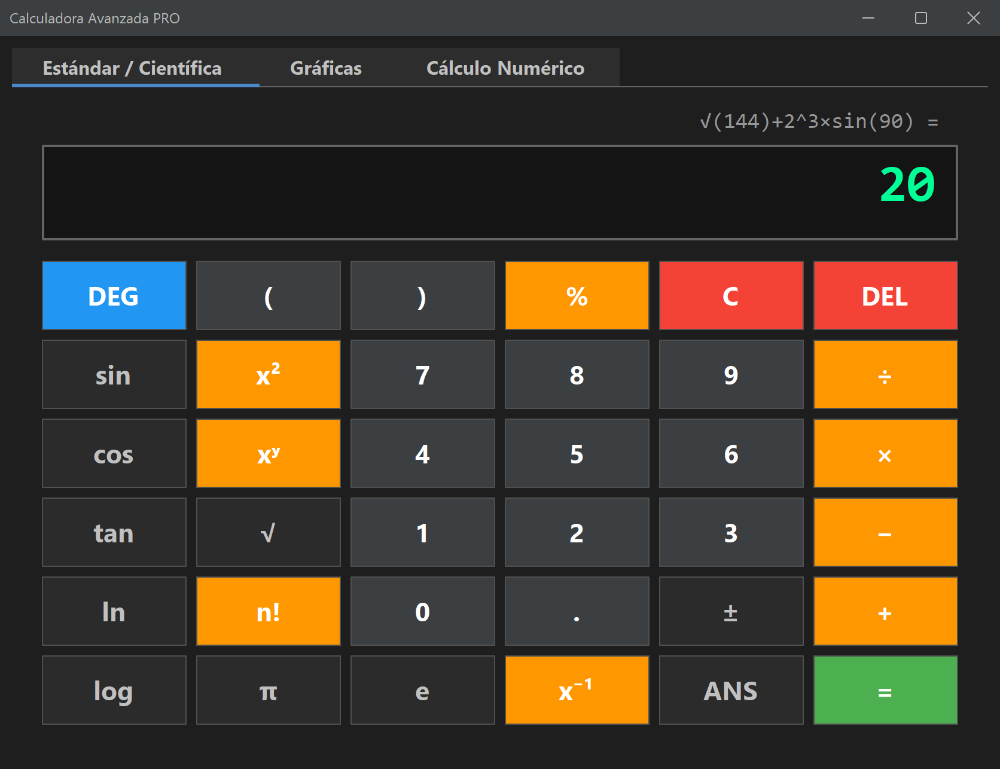
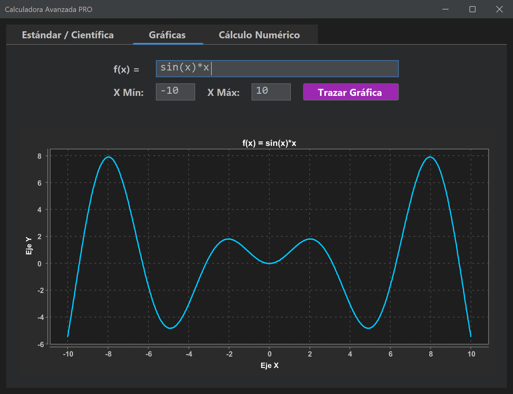
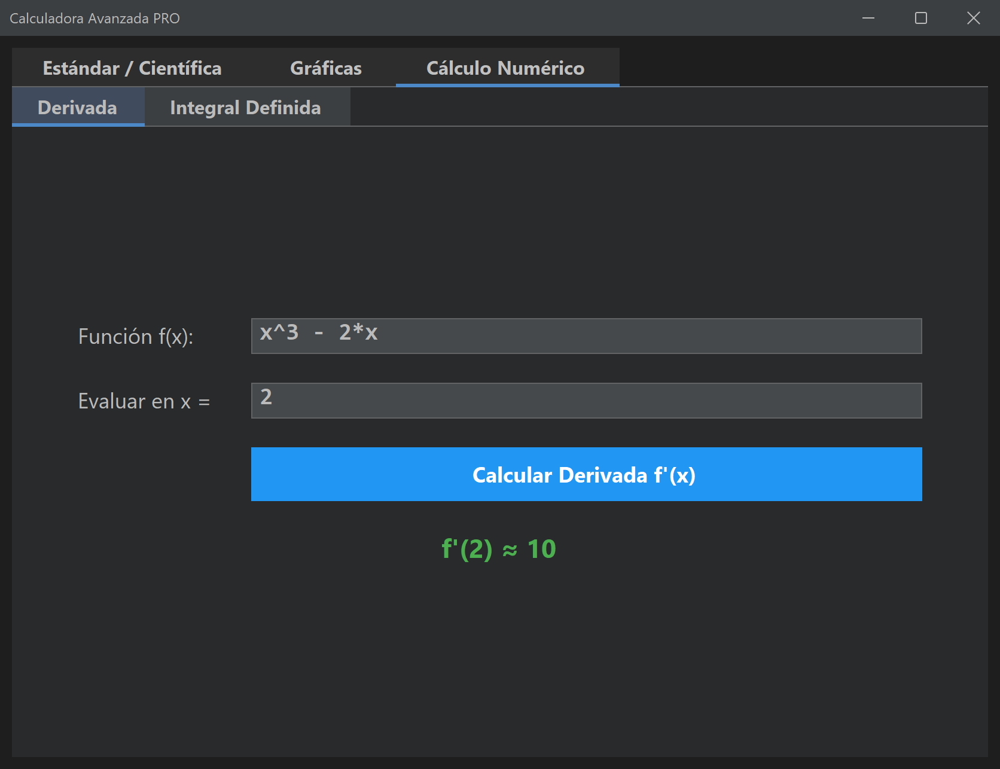
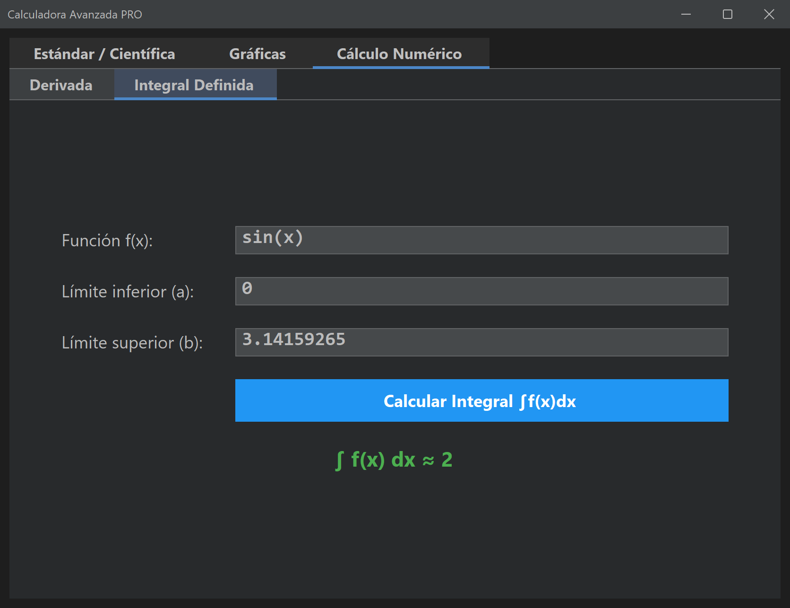

<div align="center">

# 🧮 Calculadora Avanzada en Java

**Calculadora científica, gráfica y de cálculo numérico hecha con Java Swing**




</div>

---

## 📖 Descripción

Aplicación de escritorio que reúne en una sola ventana tres herramientas matemáticas:

1. **Calculadora estándar / científica** con jerarquía de operaciones y paréntesis.
2. **Graficador 2D** de funciones `f(x)` en un intervalo definido por el usuario.
3. **Cálculo numérico**: derivada en un punto e integral definida.

El proyecto sigue una separación tipo **MVC** (lógica matemática por un lado, interfaz por otro) y se gestiona con **Maven**, así que se abre directamente en NetBeans, IntelliJ IDEA, Eclipse o VS Code.

## ✨ Características

| Módulo | Qué hace |
|---|---|
| **Estándar / Científica** | Operaciones `+ − × ÷`, potencias, `x²`, `x⁻¹`, `√`, `n!`, `%`, `±`, `sin`, `cos`, `tan`, `log`, `ln`, constantes `π` y `e`, y la tecla `ANS` con el último resultado. Modo **RAD / DEG** para los ángulos. Resultados limpios (`0.1+0.2 = 0.3`, `sin(π) = 0`) y notación científica para números muy grandes o pequeños. |
| **Teclado físico** | Puedes escribir la operación completa con el teclado; `Enter` calcula, `Esc` borra y `Ctrl+C` / `Ctrl+V` copian y pegan. |
| **Gráficas** | Dibuja cualquier `f(x)` entre un `X mín` y un `X máx` con 800 puntos de muestreo. Deja huecos donde la función no existe y corta la línea en las asíntotas (`1/x`, `tan(x)`). |
| **Derivada** | Derivada numérica en un punto mediante **diferencias finitas centrales** con paso adaptado a la magnitud de `x`. |
| **Integral definida** | Integral en `[a, b]` mediante la **regla de Simpson 1/3** (1000 subintervalos). |
| **Errores claros** | Los errores se muestran en rojo dentro de la ventana, indicando qué campo revisar, sin ventanas emergentes. |
| **Tema oscuro** | Interfaz moderna con **FlatLaf** (Dark). |

## 📸 Capturas

<table>
  <tr>
    <td align="center" colspan="2">
      <br>
      <sub><b>Graficador</b> — f(x) = sin(x)·x en [-10, 10]</sub>
    </td>
  </tr>
  <tr>
    <td align="center">
      <br>
      <sub><b>Derivada</b> — f(x) = x³ − 2x evaluada en x = 2</sub>
    </td>
    <td align="center">
      <br>
      <sub><b>Integral</b> — ∫ sin(x) dx de 0 a π = 2</sub>
    </td>
  </tr>
</table>

## 🏗️ Arquitectura

```
src/main/java/com/calculadora
├── main
│   └── Main.java            → Punto de entrada, aplica el tema FlatLaf
├── math                     → Modelo (lógica pura)
│   ├── EvaluadorMath.java   → Evalúa expresiones y funciones f(x)
│   ├── FormatoNumero.java   → Presenta los resultados de forma legible
│   └── Calculus.java        → Derivada (diferencias centrales) e integral (Simpson)
└── gui                      → Vista / Controlador
    ├── MainFrame.java       → Ventana principal con pestañas
    ├── StandardPanel.java   → Teclado y pantalla de la calculadora
    ├── GraphPanel.java      → Controles y gráfica de f(x)
    └── CalculusPanel.java   → Pestañas de derivada e integral
```

## 🛠️ Tecnologías

- **Java 8+** — lenguaje base.
- **Maven** — dependencias y empaquetado.
- **[exp4j](https://www.objecthunter.net/exp4j/)** — motor de evaluación de expresiones.
- **[XChart](https://knowm.org/open-source/xchart/)** — gráficos cartesianos.
- **[FlatLaf](https://www.formdev.com/flatlaf/)** — Look and Feel moderno para Swing.

## 🚀 Instalación y ejecución

### Requisitos

- JDK 8 o superior.
- Maven 3.6+ (no es necesario si usas NetBeans o IntelliJ, ya lo traen integrado).

### Opción 1 — NetBeans

1. Clona el repositorio:
   ```bash
   git clone https://github.com/AcuLuis/Calculadora_Java.git
   ```
2. En NetBeans: **File → Open Project…** y selecciona la carpeta `Calculadora_Java` (se reconoce como proyecto Maven).
3. Espera a que se descarguen las dependencias.
4. Pulsa **Run Project (F6)**. Si te pide la clase principal, elige `com.calculadora.main.Main`.

### Opción 2 — Terminal

```bash
mvn clean package
java -jar target/calculadora-avanzada-1.0-SNAPSHOT-jar-with-dependencies.jar
```

## ✍️ Sintaxis de las expresiones

| Escribe | Significa |
|---|---|
| `2^3` | Potencia (2³) |
| `sqrt(x)` o `√(x)` | Raíz cuadrada |
| `5!` | Factorial (120) |
| `50%`, `200*10%` | Porcentaje (0.5 y 20) |
| `ANS` | Último resultado calculado |
| `sin(x)`, `cos(x)`, `tan(x)` | Trigonométricas (en **radianes**, o en grados con el botón **DEG**) |
| `asin(x)`, `acos(x)`, `atan(x)` | Trigonométricas inversas |
| `log(x)` | Logaritmo en **base 10** |
| `ln(x)` | Logaritmo **natural** |
| `log2(x)` | Logaritmo en base 2 |
| `abs(x)`, `exp(x)`, `cbrt(x)` | Valor absoluto, eˣ, raíz cúbica |
| `pi` o `π`, `e` | Constantes π y e |
| `2pi`, `3(x+1)` | Multiplicación implícita |

> 💡 En los modos **Gráficas** y **Cálculo Numérico** la variable debe llamarse `x`. Los límites y el punto de evaluación también aceptan expresiones, por ejemplo `pi/2` o `-2*pi`.

## ⌨️ Atajos de teclado

| Tecla | Acción |
|---|---|
| `0`–`9`, `.` o `,` | Escribir números |
| `+` `-` `*` `/` `^` `(` `)` `%` `!` | Operadores |
| Letras (`sin`, `sqrt`, `pi`, `ans`…) | Escribir funciones y constantes |
| `Enter` o `=` | Calcular |
| `Retroceso` | Borrar el último carácter (o la función completa, como `sin(`) |
| `Esc` o `Supr` | Borrar todo |
| `Ctrl+C` / `Ctrl+V` | Copiar el resultado / pegar una expresión |
| `Enter` en Gráficas y Cálculo Numérico | Trazar o calcular sin usar el ratón |

> Si te falta un paréntesis de cierre, la calculadora lo agrega por ti: `sin(30` se calcula como `sin(30)`.

---

<div align="center">

## ⭐ ¿Te gustó el proyecto?

Si esta calculadora te fue útil, te ayudó a estudiar o simplemente te pareció interesante,<br>
**regálame una estrella** en GitHub. Es gratis, toma un segundo y me motiva muchísimo a seguir mejorándola. 🙌

<a href="https://github.com/AcuLuis/Calculadora_Java/stargazers">
  
</a>

¿Encontraste un error o tienes una idea? Abre un [issue](https://github.com/AcuLuis/Calculadora_Java/issues) — toda sugerencia es bienvenida.

<br>

Hecho con ☕ y Java por **[Luis Antonio Acuña Ayala](https://github.com/AcuLuis)**

</div>
